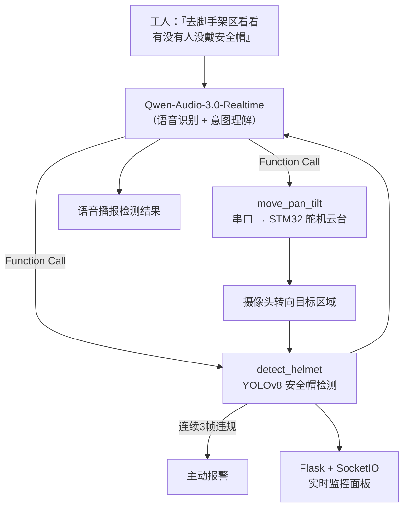

# 智巡哨兵 · SmartGuard

> 面向工地安全的语音交互式具身智能巡检系统 —— 说一句话，它听懂、转过去、看、再告诉你结果

[](https://github.com/QwenLM)
[](https://github.com/ultralytics/ultralytics)
[](https://www.st.com)

**2026 年天津市第九届大学生信息技术「新工科」工程实践创新技术竞赛** — 自主命题 A 类

---

## 📌 Problem（背景与问题）

工地安全事故里，**安全帽没戴**是高频风险。传统做法是人工巡检或固定摄像头回看，但：

- 人工巡检覆盖不全、人力成本高
- 固定摄像头只能盯一个方向，且「拍到」≠「当场制止」
- 工人戴不戴帽、哪里没戴，需要**当场、实时**发现并提醒

**目标**：做一个工人能**用嘴指挥**、系统能**用眼看 + 用嘴回**的巡检哨兵。

## 🤖 Why Agent（为什么是 Agent，而不是单一模型）

这个系统本质上是一个**多模态具身 Agent**，一个闭环里有四种完全不同的能力：

```
听（语音）→ 想（意图）→ 动（云台）→ 看（检测）→ 说（播报）
```

单一模型做不到「听懂指令 + 控制硬件 + 视觉检测 + 语音合成」。只有 Agent 范式——**LLM 理解意图 → Function Call 触发工具 → 工具执行物理动作 → 结果回传再生成语音**——才能串起这个闭环。

## 🏗️ Architecture（架构）



## 🛠️ Skills（核心能力）

| 能力 | 实现 | 说明 |
|------|------|------|
| 🎙️ 语音交互 | Qwen-Audio-3.0-Realtime | 一个模型完成识别 + 意图理解 + 合成，支持 Function Call |
| 🦺 安全帽检测 | YOLOv8（SafetyVision 13 类） | CUDA 加速，区分「已佩戴 / 未佩戴 / 人员」 |
| 🤖 具身控制 | 串口 → STM32 舵机云台 | 语音指令解析空间方位词，控制云台转向 |
| 🚨 主动报警 | 后台线程 | 连续 3 帧违规自动告警 |
| 📊 实时面板 | Flask + SocketIO | 视频流 / 区域地图 / 统计 / 事件日志 |
| 🔌 硬件可选 | 降级模拟模式 | STM32 不在线时软件链路仍完整可跑 |

## 🧰 Tools（技术栈）

- **语音**：Qwen-Audio-3.0-Realtime（WebSocket + Function Call）
- **视觉**：YOLOv8（SafetyVision），CUDA 加速
- **硬件**：STM32F103 + SG90 舵机云台，串口通信
- **可视化**：Flask + SocketIO Dashboard

## 🧠 Memory（记忆 / 状态）

Agent 需要记住「短期状态」才能做对判断：

- **连续帧计数**：单帧误检会误报，所以后台线程维护「连续 3 帧违规」的短期记忆，去抖动后才报警
- **事件日志**：每次检测/报警/云台动作都记入日志，面板可回溯

## 📊 Eval（评估 / 验证）

- **去抖动验证**：3 帧连续判定，避免单帧误检导致的假报警
- **降级测试**：断开 STM32 → 系统自动进模拟模式，语音/检测/面板链路仍完整
- **分类精度**：YOLOv8 SafetyVision 13 类模型，区分已佩戴 / 未佩戴 / 人员三类

## 💥 Failure Cases（失败案例 / 边界）

| 失败场景 | 表现 | 解法 |
|---------|------|------|
| 单帧误检安全帽 | 一闪而过的物体触发报警 | 连续 3 帧去抖 |
| STM32 未连接 | 云台不响应，链路中断 | 自动降级模拟模式 |
| 语音指令含模糊方位词 | 云台转向不准 | 方位词 → 角度映射规则 |
| 串口通信不稳定 | 舵机偶发丢步 | 串口重连 + 状态校验 |

## 🎨 Design Decisions（设计决策）

| 决策 | 理由 | 代价 |
|------|------|------|
| 一个模型做语音全链路（Qwen-Audio） | 省掉 ASR+TTS 两个模块，简化架构 | 依赖单模型能力 |
| Function Call 驱动硬件 | LLM 直接产出结构化动作，天然适配 | 需校验动作合法性 |
| 硬件可选 + 降级 | 演示/开发不受硬件拖累 | 需维护模拟路径 |
| 连续帧去抖 | 工地环境误检多，必须压假报警 | 延迟 +3 帧 |

---

*这是一个「软件 Agent + 物理硬件」的交叉项目——它证明了我能跨语音、视觉、嵌入式三层，把 Agent 落到真实物理世界。*
